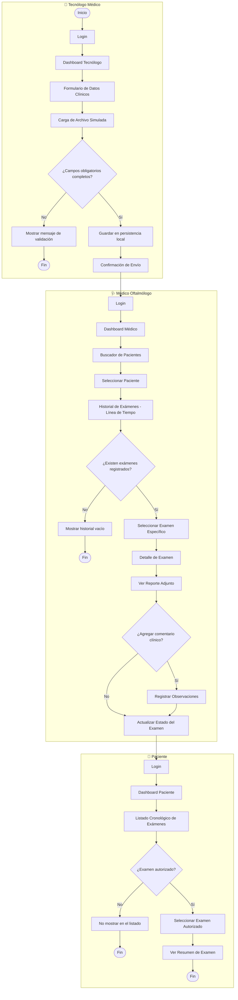

# VisionSync

Aplicación móvil para la gestión centralizada de exámenes oftalmológicos, desarrollada como proyecto del ramo **Desarrollo de Aplicaciones Móviles**.

## Problema que resuelve

Los exámenes oftalmológicos (campimetría, topografía, agudeza visual) se generan hoy en formatos distintos (PDF, Excel, imágenes) y quedan dispersos entre carpetas locales, correos y entregas físicas. No existe una ficha digital única por paciente, lo que obliga al especialista a revisar múltiples documentos separados y comparar antecedentes manualmente, aumentando el tiempo de consulta y el riesgo de pérdida o confusión de información.

**VisionSync** unifica esos registros en un solo lugar, sincronizado y accesible según el rol de cada usuario (Tecnólogo Médico, Médico Oftalmólogo y Paciente).

---

## Identidad visual

  

El logo traduce visualmente el nombre: un ojo formado por líneas curvas en movimiento que convergen hacia el centro, representando datos dispersos que se unifican (el "Sync"). Los tonos azules aportan confianza y carácter clínico/tecnológico.

### Paleta de colores

| Color | HEX | Uso en la app |
|---|---|---|
| 🟦 Principal | `#3A4BBE` | Primario/marca (identidad, acción principal) |
| 🔵 Secundario | `#3F8EFC` | Interactivo/secundario (links, elementos táctiles) |
| ⬜ Fondo | `#F7F4F3` | Base/fondo (pantallas, tarjetas) |
| 🔷 Texto | `#1E3B48` | Contenido (texto, íconos informativos) |
| ⬛ Adicional | `#000000` | Énfasis máximo (uso puntual) |
| 🟩 Adicional | `#20A39E` | Confirmación/éxito (estados positivos) |

---

## Flujo de usuario (Diagrama de Actividad UML)

Recorrido principal end-to-end: registro del examen → revisión clínica → consulta del paciente.

---

## Pantallas principales

| Pantalla | Objetivo | Usuario principal | Imágenes |
|---|---|---|---|
| Pantalla de Login | Autenticar al usuario y determinar su rol | Todos los perfiles | `docs/diseno/interfaces/Login.png` |
| Dashboard Principal (rol-dependiente) | Centralizar accesos rápidos por rol | Todos los perfiles | `DashboardTecnologo.png` · `DashboardTecnologoInicio.png` · `DashboardMedicoOftalmologo.png` · `PortalPaciente.png` |
| Formulario de Registro de Examen | Capturar datos clínicos y adjuntar archivo | Tecnólogo Médico | `docs/diseno/interfaces/RegistrarExamen.png` |
| Confirmación de Envío / Validación | Confirmar guardado o mostrar errores de validación | Tecnólogo Médico | `docs/diseno/interfaces/ConfirmacionExamen.png` |
| Buscador y Listado de Pacientes/Exámenes | Localizar pacientes o registros mediante filtros | Médico Oftalmólogo | `docs/diseno/interfaces/BusquedaExamenesOftalmologo.png` |
| Historial Clínico del Paciente | Mostrar cronológicamente los exámenes previos | Médico Oftalmólogo | `docs/diseno/interfaces/HistorialClinicoLineaDelTiempo.png` |
| Detalle de Examen (Reporte + Comentarios) | Ver reporte adjunto y registrar observaciones | Médico Oftalmólogo | `DetalleExamenOftalmologico.png` · `DetalleOftalmologico2.png` |
| Resumen de Examen | Mostrar resultado autorizado y estado de entrega | Paciente | `docs/diseno/interfaces/ResumenExamenPaciente.png` |

*Todas las imágenes se encuentran en `docs/diseno/interfaces/`. Algunas pantallas tienen más de una variante (ej. distintos estados del Dashboard según el rol, o vistas colapsada/expandida del Detalle de Examen).*

---

## Integrantes — Equipo 3 "Salu Por Eso"

| Nombre | Rol |
|---|---|
| Diego Uribe | Líder del grupo, desarrollador backend |
| Job Arjel | Desarrollador frontend |
| Sebastián Díaz | Desarrollador FullStack, Tester QA |
| Isidora Ayala | Desarrollador frontend |

---

## Tecnologías

- **Diseño de interfaces:** Google Stitch (Material Design 3)
- **Diagramación UML:** PlantUML / Mermaid
- **Desarrollo (planificado):** Android nativo con Jetpack Compose
