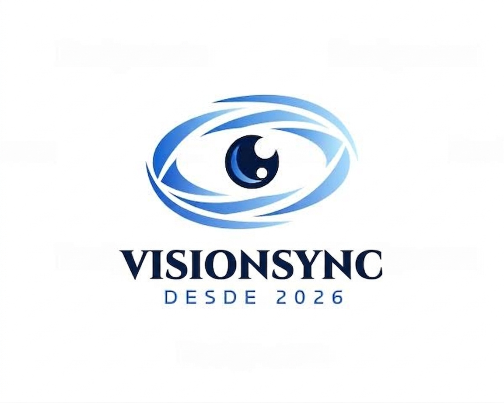
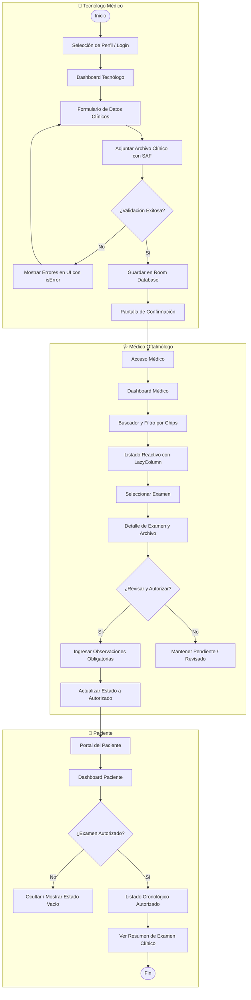

# VisionSync
**Plataforma Móvil para la Gestión Centralizada y Trazabilidad de Exámenes Oftalmológicos**  
*Asignatura:* Desarrollo de Aplicaciones Móviles (DSY1105)  
*Equipo 3:* «Salu Por Eso»  


<p align="center">

</p>
---

El logo traduce visualmente el nombre: un ojo formado por líneas curvas en movimiento que convergen hacia el centro, representando datos dispersos que se unifican (el "Sync"). Los tonos azules aportan confianza y carácter clínico/tecnológico.

### Paleta de colores

| Color | HEX | Uso en la app |
|---|---|---|
| 🟦 Principal | `#3A4BBE` | Primario/marca (identidad, acción principal) |
| 🔵 Secundario | `#3F8EFC` | Interactivo/secundario (links, elementos táctiles) |
| ⬜ Fondo | `#F7F4F3` | Base/fondo (pantallas, tarjetas) |
| 🔷 Texto | `#1E3B48` | Contenido (texto, íconos informativos) |
| ⬛ Adicional | `#000000` | Énfasis máximo (uso puntual) |
| 🟩 Adicional | `#20A39E` | Confirmación/éxito (estados positivos) |

## 2. Identidad Visual y Diseño
La identidad gráfica de VisionSync está inspirada en las líneas de escaneo ocular convergentes hacia un punto focal, simbolizando la integración de datos clínicos dispersos (*"Sync"*).

<p align="center">
  
</p>

## Flujo de usuario (Diagrama de Actividad UML)

Recorrido principal end-to-end: registro del examen → revisión clínica → consulta del paciente.



### 3.2 Patrón Arquitectónico MVVM
El proyecto implementa la arquitectura oficial promovida por Android:
* **UI Layer (Jetpack Compose):** Pantallas declarativas (`ui/screens`) y componentes reutilizables (`ui/components`). Consumen estados inmutables mediante `collectAsState()`.
* **ViewModel Layer (`viewmodel/`):** Aloja las reglas de validación, la gestión de estados (`StateFlow` y `UiState`) y la coordinación de corrutinas (`viewModelScope`). **Ninguna regla de validación reside en la interfaz visual**.
* **Data Layer (`data/` y `repository/`):** Repositorio como fuente única de verdad (`ExamenRepository`), mediando con el DAO de Room (`ExamenDao`) y exponiendo datos reactivos en flujos asíncronos (`Flow`).

---

## 4. Requerimientos Funcionales y Cobertura de Rúbrica
| ID | Requerimiento Funcional | Responsable | Estado | Implementación Técnica |
| :---: | :--- | :---: | :---: | :--- |
| **RF1** | Selección de Perfil y Control de Acceso | Diego (A) | ✅ **Listo** | `PerfilScreen` y `LoginScreen` con `LoginViewModel`, validación de campos y `NavHost`. |
| **RF2** | Registro de Examen con Formulario Validado | Diego (A) | ✅ **Listo** | `RegistroExamenViewModel` con validación de RUT módulo 11, tipos de examen y estados Material 3 (`isError`, `supportingText`). |
| **RF3** | Carga de Documento Clínico (**Recurso Nativo 1**) | Diego (A) | ✅ **Listo** | Storage Access Framework (`OpenDocument`) sin necesidad de permisos riesgosos en manifest; extracción de nombre legible y permisos persistentes. |
| **RF4** | Búsqueda y Filtrado de Exámenes | Job (B) | 🔧 **Integrando** | `ExamenesViewModel` combinando flujos con operador `combine` (texto de búsqueda + chips por tipo de examen). |
| **RF5** | Detalle Clínico, Observaciones y Estados | Job (B) | 🔧 **Integrando** | `DetalleExamenScreen` con actualización de estado (`Pendiente` → `Revisado` → `Autorizado`) y validación de comentarios clínicos obligatorios. |
| **RF6** | Portal del Paciente y Resumen de Diagnóstico | Sebastián (C) | 🔧 **Integrando** | `PacienteViewModel` consumiendo `observarAutorizados()`, `DashPacienteScreen` con estado vacío amigable y `ResumenExamenScreen`. |
| **RF7** | Monitor de Red en Tiempo Real (**Recurso Nativo 2**) | Sebastián (C) | 🔧 **Integrando** | `ConnectivityManager` + `NetworkCallback` en `util/ConexionUtil.kt` expuesto con `callbackFlow` y componente visual `EstadoConexion`. |

### Regla de Negocio Crítica (Seguridad de Ficha Clínica)
Los exámenes en estado **Pendiente** o **Revisado** son de exclusivo uso clínico y **nunca deben mostrarse al paciente**. Esta regla se garantiza en dos capas:
1. **Capa de Base de Datos:** Consulta SQL dedicada en el DAO: `@Query("SELECT * FROM examenes WHERE estado = 'Autorizado' ORDER BY id DESC")`.
2. **Capa de Presentación:** El `PacienteViewModel` expone únicamente el flujo seguro hacia el portal.

---

## 5. Implementación de Recursos Nativos del Dispositivo (Indicador 2.4.1 - 15%)
| Recurso | Tecnología / API | Permiso Requerido | Justificación y Funcionamiento |
| :--- | :--- | :---: | :--- |
| **1. Selector de Archivos SAF** | `ActivityResultContracts.OpenDocument()` | *Ninguno (No requiere)* | Permite al tecnólogo adjuntar imágenes y PDFs del examen. El Storage Access Framework delega la elección al sistema operativo, otorgando acceso seguro de lectura sin solicitar permisos globales de almacenamiento. |
| **2. Estado de Conexión de Red** | `ConnectivityManager` + `NetworkCallback` | `ACCESS_NETWORK_STATE` | Monitorea la disponibilidad de red en vivo mediante `callbackFlow`. Alerta en los dashboards si el dispositivo entra en modo avión o pierde conectividad con el badge `EstadoConexion`. |

---

## 6. Equipo de Desarrollo y Planificación (Indicador 2.3.2 - 20%)

### 6.1 Integrantes — Equipo 3 «Salu Por Eso»
| Nombre | Rol Asignado | Responsabilidad Técnica | Rama de Trabajo |
| :--- | :--- | :--- | :---: |
| **Diego Uribe** | Integrante A | Navegación, Login, Formulario de Registro de Examen, validaciones (RUT módulo 11), Recurso Nativo 1 (SAF) y ViewModel Factory. | `feature/registro-examen`<br>`feature/mejoras-tecnologo` |
| **Job Arjel** | Integrante B | Arquitectura Room (Entity, DAO, Database, Repository), precarga de datos de prueba, Dashboard Médico, Buscador reactivo y Detalle con observaciones. | `feature/room-datos` |
| **Sebastián Díaz** | Integrante C | Portal del Paciente (listado y resumen de autorizados), Recurso Nativo 2 (conectividad y permisos), gestión de tablero Trello y documentación técnica. | `feature/portal-paciente` |

### 6.2 Gestión y Trazabilidad en Trello
La planificación ágil y el avance de los sprints se gestionan en el tablero oficial:  
🔗 **Tablero Oficial en Trello:** [VisionSync – Equipo 3](https://trello.com/b/o359VJG6/visionsync-equipo-3)  
*Estructura de columnas:* `Por hacer` ➔ `En curso` ➔ `En revisión` ➔ `Hecho`.

### 6.3 Políticas de Control de Versiones (Git)
* Commits semánticos y atómicos: `feat:`, `fix:`, `docs:`, `chore:`, `refactor:`.
* Todo código se integra a `main` mediante **Pull Requests (PR)** revisados y aprobados por otro integrante.
* Exclusión estricta de artefactos de compilación y archivos de entorno (`.idea/`, `build/`, `*.iml`, `local.properties`, `.gradle/`).

---

## 7. Tecnologías y Librerías Utilizadas
* **Lenguaje:** Kotlin 2.2.10
* **Kit de UI:** Jetpack Compose (BOM 2026.02.01) + Material Design 3
* **Navegación:** AndroidX Navigation Compose 2.8.5
* **Arquitectura:** Lifecycle ViewModel Compose 2.8.7
* **Persistencia Local:** AndroidX Room (Runtime, KTX y KSP Compiler)
* **Concurrencia y Asincronía:** Kotlin Coroutines & Asynchronous Flows (`StateFlow`, `SharedFlow`, `callbackFlow`)
* **Testing:** JUnit 4 para pruebas unitarias de validación algorítmica
* **Herramientas de Build:** Android Gradle Plugin (AGP) 9.3.3 · Gradle 9.5.0

---

## 8. Estructura de Paquetes del Proyecto
```text
app/src/main/java/com/duoc/visionsyncc1/
├── MainActivity.kt                 # Punto de entrada de la actividad (Theme + AppNavigation)
├── VisionSyncApp.kt                # Application class (inicialización Singleton de Room)
├── model/
│   └── ExamenEntity.kt             # Entidad de persistencia Room (@Entity)
├── data/
│   ├── AppDatabase.kt              # Base de datos RoomDatabase con patrón Singleton
│   └── ExamenDao.kt                # Data Access Object con consultas SQL y Flow
├── repository/
│   └── ExamenRepository.kt         # Abstracción y repositorio de datos
├── viewmodel/
│   ├── AppViewModelProvider.kt     # Factory para inyección de repositorios
│   ├── LoginViewModel.kt           # Estado y validación de acceso
│   ├── RegistroExamenViewModel.kt  # Validación y registro de exámenes
│   ├── ExamenesViewModel.kt        # Filtrado reactivo para el médico
│   └── PacienteViewModel.kt        # Flujo exclusivo de exámenes autorizados
├── navigation/
│   ├── Rutas.kt                    # Constantes de destinos de navegación
│   └── AppNavigation.kt            # NavHost centralizado con rutas protegidas
├── util/
│   ├── Validaciones.kt             # Algoritmo módulo 11 de RUT chileno
│   └── ConexionUtil.kt             # Monitoreo reactivo de red (callbackFlow)
└── ui/
    ├── theme/                      # Color.kt, Theme.kt, Type.kt (Material 3)
    ├── components/                 # Componentes reutilizables (EstadoConexion, Cards)
    └── screens/                    # Pantallas de la aplicación
        ├── PerfilScreen.kt
        ├── LoginScreen.kt
        ├── DashTecnologoScreen.kt
        ├── RegistroExamenScreen.kt
        ├── ConfirmacionScreen.kt
        ├── DashMedicoScreen.kt
        ├── BuscadorScreen.kt
        ├── DetalleExamenScreen.kt
        ├── DashPacienteScreen.kt
        └── ResumenExamenScreen.kt
```

---

## 9. Instrucciones de Clonación, Compilación y Ejecución

### Requisitos Previos del Entorno
* **Android Studio:** Ladybug (2024.2.1+) o superior, con soporte para AGP 9.3.
* **JDK:** Java 25 (JetBrains Runtime `jbr-25` incluido en Android Studio).
* **SDK Mínimo (`minSdk`):** Nivel de API 24 (Android 7.0 Nougat).
* **SDK de Compilación (`compileSdk` / `targetSdk`):** Nivel de API 37.
* **Dispositivo de Prueba:** Emulador Android (Pixel 6, API 34 o superior) o teléfono físico con depuración USB activada.

### Pasos para Ejecutar
1. Clonar el repositorio desde GitHub:
   ```bash
   git clone https://github.com/MrDeguitoo/VisionSync.git
   cd VisionSync
   ```
2. Abrir la carpeta raíz en **Android Studio** (*File → Open*).
3. Aguardar la sincronización automática de Gradle.
4. Ejecutar las pruebas unitarias locales en terminal:
   ```bash
   ./gradlew testDebugUnitTest
   ```
5. Seleccionar el emulador en el menú de dispositivos y pulsar **Run ▶** (o `Shift + F10`).
6. **Verificación de los Recursos Nativos:**
   * *Selector SAF:* En el perfil Tecnólogo, pulsar «Adjuntar Informe» y elegir un archivo PDF/imagen de prueba.
   * *Monitor de Red:* Desplegar la barra superior de Android en el emulador y activar/desactivar el **Modo Avión** para comprobar la reactividad del componente `EstadoConexion`.
