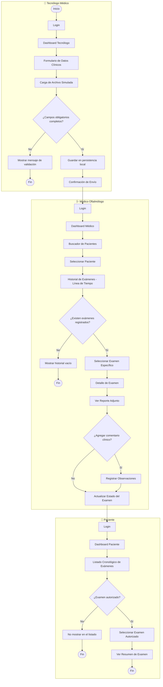

# VisionSync

Aplicación móvil para la gestión centralizada de exámenes oftalmológicos, desarrollada como proyecto del ramo **Desarrollo de Aplicaciones Móviles**.

## Problema que resuelve

Los exámenes oftalmológicos (campimetría, topografía, agudeza visual) se generan hoy en formatos distintos (PDF, Excel, imágenes) y quedan dispersos entre carpetas locales, correos y entregas físicas. No existe una ficha digital única por paciente, lo que obliga al especialista a revisar múltiples documentos separados y comparar antecedentes manualmente, aumentando el tiempo de consulta y el riesgo de pérdida o confusión de información.

**VisionSync** unifica esos registros en un solo lugar, sincronizado y accesible según el rol de cada usuario (Tecnólogo Médico, Médico Oftalmólogo y Paciente).

---

## Identidad visual

<p align="center">
  
</p>

El logo traduce visualmente el nombre: un ojo formado por líneas curvas en movimiento que convergen hacia el centro, representando datos dispersos que se unifican (el "Sync"). Los tonos azules aportan confianza y carácter clínico/tecnológico.

### Paleta de colores

| Color | HEX | Uso en la app |
|---|---|---|
| 🟦 Principal | `#3A4BBE` | Primario/marca (identidad, acción principal) |
| 🔵 Secundario | `#3F8EFC` | Interactivo/secundario (links, elementos táctiles) |
| ⬜ Fondo | `#F7F4F3` | Base/fondo (pantallas, tarjetas) |
| 🔷 Texto | `#1E3B48` | Contenido (texto, íconos informativos) |
| ⬛ Adicional | `#000000` | Énfasis máximo (uso puntual) |
| 🟩 Adicional | `#20A39E` | Confirmación/éxito (estados positivos) |

---

## Flujo de usuario (Diagrama de Actividad UML)

Recorrido principal end-to-end: registro del examen → revisión clínica → consulta del paciente.



---

## Pantallas principales

| Pantalla | Objetivo | Usuario principal | Imágenes |
|---|---|---|---|
| Pantalla de Login | Autenticar al usuario y determinar su rol | Todos los perfiles | `docs/diseno/interfaces/Login.png` |
| Dashboard Principal (rol-dependiente) | Centralizar accesos rápidos por rol | Todos los perfiles | `DashboardTecnologo.png` · `DashboardTecnologoInicio.png` · `DashboardMedicoOftalmologo.png` · `PortalPaciente.png` |
| Formulario de Registro de Examen | Capturar datos clínicos y adjuntar archivo | Tecnólogo Médico | `docs/diseno/interfaces/RegistrarExamen.png` |
| Confirmación de Envío / Validación | Confirmar guardado o mostrar errores de validación | Tecnólogo Médico | `docs/diseno/interfaces/ConfirmacionExamen.png` |
| Buscador y Listado de Pacientes/Exámenes | Localizar pacientes o registros mediante filtros | Médico Oftalmólogo | `docs/diseno/interfaces/BusquedaExamenesOftalmologo.png` |
| Historial Clínico del Paciente | Mostrar cronológicamente los exámenes previos | Médico Oftalmólogo | `docs/diseno/interfaces/HistorialClinicoLineaDeTiempo.png` |
| Detalle de Examen (Reporte + Comentarios) | Ver reporte adjunto y registrar observaciones | Médico Oftalmólogo | `DetalleExamenOftalmologico.png` · `DetalleOftalmologico2.png` |
| Resumen de Examen | Mostrar resultado autorizado y estado de entrega | Paciente | `docs/diseno/interfaces/ResumenExamenPaciente.png` |

*Todas las imágenes se encuentran en `docs/diseno/interfaces/`. Algunas pantallas tienen más de una variante (ej. distintos estados del Dashboard según el rol, o vistas colapsada/expandida del Detalle de Examen).*

---

## Integrantes — Equipo 3 "Salu Por Eso"

| Nombre | Rol en el equipo | Responsabilidad técnica | Rama de trabajo |
|---|---|---|---|
| Diego Uribe | Líder del grupo, desarrollador backend | _(completar: ej. Room, DAO, repositorio)_ | `feature/...` |
| Job Arjel | Desarrollador frontend | _(completar: ej. dashboard y formulario del Tecnólogo)_ | `feature/...` |
| Sebastián Díaz | Desarrollador FullStack, Tester QA | Portal del paciente, estado de conexión (recurso nativo 2), gestión Git y documentación | `feature/portal-paciente` |
| Isidora Ayala | Desarrollador frontend | _(completar: ej. dashboard del Médico)_ | `feature/...` |

Flujo de trabajo: cada integrante trabaja en su propia rama, hace commits atómicos con prefijos convencionales (`feat:`, `fix:`, `docs:`, `chore:`, `refactor:`) y los integra a `main` mediante Pull Request revisado por al menos otro integrante.

---

## Planificación

Tablero Trello del equipo: **[VisionSync – Equipo 3](PEGAR_AQUI_EL_ENLACE_DE_TRELLO)**

Columnas: *Por hacer* → *En curso* → *En revisión* → *Hecho*.

---

## Requerimientos funcionales

> Ajustar nombres y estados a la pauta oficial del curso. Estados: ✅ Implementado · 🔧 En desarrollo · ⏳ Pendiente.

| ID | Requerimiento | Estado |
|---|---|---|
| RF1 | Selección de perfil / acceso por rol (Tecnólogo, Médico, Paciente) | 🔧 |
| RF2 | Registro de examen con datos clínicos y archivo adjunto simulado _(completar)_ | ⏳ |
| RF3 | Persistencia local de exámenes con Room _(completar)_ | ⏳ |
| RF4 | Dashboard y buscador del Médico Oftalmólogo _(completar)_ | ⏳ |
| RF5 | Detalle de examen, observaciones y cambio de estado (Pendiente → Revisado → Autorizado) _(completar)_ | ⏳ |
| RF6 | Portal del Paciente: listado y resumen de exámenes en estado **Autorizado** únicamente | ⏳ |
| RF7 | Recurso nativo: indicador de estado de conexión de red en tiempo real | 🔧 |

### Regla de negocio principal

El paciente solo puede ver exámenes en estado **Autorizado**. El filtro se aplica en dos capas: en la consulta del DAO y nuevamente en el `ViewModel`. Los exámenes «Pendiente» o «Revisado» nunca llegan a la interfaz del paciente.

### Recurso nativo: estado de conexión (RF7)

- Permiso declarado: `ACCESS_NETWORK_STATE`.
- `ConnectivityManager` + `NetworkCallback` expuestos como `Flow<Boolean>` mediante `callbackFlow` (`util/ConexionUtil.kt`).
- Componente reutilizable `EstadoConexion` que muestra «Sincronizado» o «Sin conexión» y reacciona de inmediato a cambios de red (por ejemplo, modo avión).

---

## Tecnologías

| Área | Tecnología |
|---|---|
| Lenguaje | Kotlin 2.2.10 |
| Interfaz | Jetpack Compose (BOM 2026.02.01) + Material Design 3 |
| Arquitectura | MVVM (ViewModel + StateFlow) |
| Navegación | Navigation Compose 2.8.5 |
| Persistencia | Room _(en integración)_ |
| Asincronía | Corrutinas y Flow |
| Recursos del dispositivo | ConnectivityManager (red) _(completar con el recurso nativo 1)_ |
| Build | Gradle 9.5.0 · Android Gradle Plugin 9.3.3 |
| Diseño de interfaces | Google Stitch (Material Design 3) |
| Diagramación UML | PlantUML / Mermaid |
| Gestión | Git, GitHub, Trello |

---

## Cómo ejecutar el proyecto

### Requisitos

| Requisito | Valor |
|---|---|
| Android Studio | _(completar con la versión exacta, ver Help → About; debe soportar AGP 9.3)_ |
| JDK | 25 (JetBrains Runtime incluido en Android Studio, `jbr-25`) |
| Gradle | 9.5.0 (lo descarga el wrapper automáticamente) |
| API mínima (`minSdk`) | 24 (Android 7.0) |
| `targetSdk` / `compileSdk` | 37 |
| Dispositivo | Emulador o teléfono con Android 7.0 o superior |

### Pasos

1. Clonar el repositorio:
   ```bash
   git clone https://github.com/<usuario>/VisionSync.git
   cd VisionSync
   ```
2. Abrir la carpeta con **Android Studio** (*File → Open*).
3. Esperar a que termine la sincronización de Gradle. Si pide descargar el JDK 25 o componentes del SDK, aceptar.
4. Crear o elegir un emulador en **Device Manager** (por ejemplo Pixel 6, API 34 o superior).
5. Presionar **Run ▶** con la configuración `app`.
6. Para probar el indicador de conexión: activar y desactivar el **modo avión** desde la barra de notificaciones del emulador.

> El archivo `local.properties` se genera automáticamente en cada equipo y no se versiona.

---

## Estructura del proyecto

```
VisionSync/
├── app/src/main/
│   ├── java/com/duoc/visionsyncc1/
│   │   ├── model/          # Entidades y modelos (PerfilAcceso, Examen)
│   │   ├── data/           # Room: base de datos y DAOs (según avance de la rama de backend)
│   │   ├── repository/     # Repositorios (PerfilRepository, ExamenRepository)
│   │   ├── viewmodel/      # ViewModels (PerfilViewModel, PacienteViewModel, ...)
│   │   ├── ui/
│   │   │   ├── components/ # Componentes reutilizables (EstadoConexion, ...)
│   │   │   ├── screens/    # Pantallas por rol
│   │   │   └── theme/      # Color, tipografía y tema
│   │   ├── util/           # Utilidades (ConexionUtil)
│   │   └── MainActivity.kt
│   ├── res/                # Recursos (strings, íconos, colores)
│   └── AndroidManifest.xml
├── docs/
│   ├── diseno/             # Logo, UML e imágenes de interfaces
│   ├── evidencias/         # Entregables por clase
│   └── capturas/           # Capturas de la aplicación en ejecución
├── gradle/                 # Wrapper y catálogo de versiones
└── README.md
```

---

## Capturas de la aplicación

> Guardar las imágenes en `docs/capturas/` y reemplazar los nombres.

| Pantalla | Captura |
|---|---|
| Selección de perfil | `` |
| Dashboard del paciente (con exámenes) | `` |
| Dashboard del paciente (estado vacío) | `` |
| Resumen de examen | `` |
| Indicador «Sincronizado» | `` |
| Indicador «Sin conexión» (modo avión) | `` |

---

## Control de versiones

- Rama principal: `main`.
- Ramas de trabajo por integrante: `feature/<nombre>`; tareas de mantenimiento en `chore/<nombre>`.
- Los cambios se integran mediante Pull Request con revisión de un compañero.
- Archivos de IDE y compilación (`.idea/`, `build/`, `*.iml`, `local.properties`, `.gradle/`) están excluidos mediante `.gitignore`.